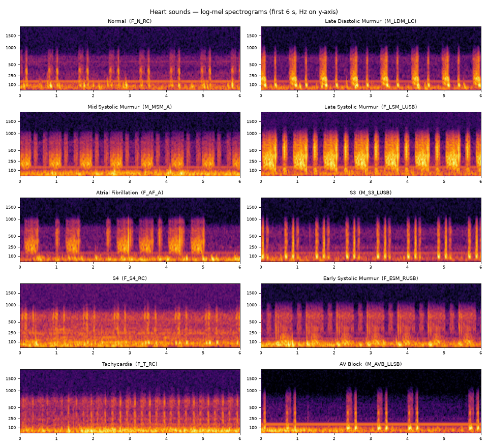
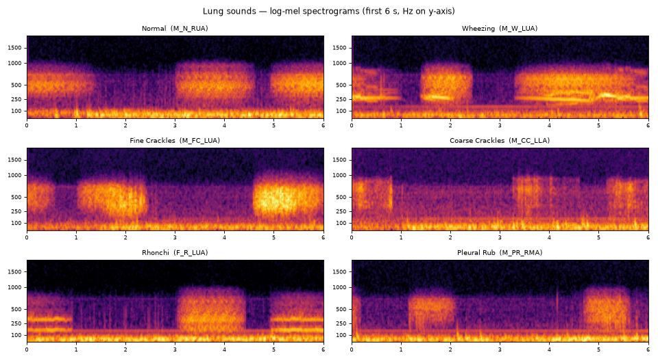

# Asculto — Auscultation Benchmark, Inference-as-a-Service & Educational Game

Stage-1 AI proof of concept for automated heart/lung sound analysis on the
**[HLS-CMDS](https://doi.org/10.1109/IEEEDATA.2025.3566012)** dataset (Torabi,
Shirani & Reilly, IEEE Data Descriptions 2025): 535 digital-stethoscope recordings
from a clinical manikin, spanning heart-only, lung-only and mixed clips.

The project delivers three things:

1. **A reproducible ML benchmark** — 3 tasks × 4 model tiers × 5-fold
   leakage-safe grouped cross-validation, tracked in Weights & Biases, with
   auditable adopt/skip gates.
2. **Inference-as-a-Service** — a FastAPI web app that turns uploads into
   explained, parametrized reports with figures and health-awareness guidance.
3. **An educational game** — a ground-truth listening drill for training.

> ⚠️ **Educational / research prototype.** Models are trained on a *manikin*
> dataset. This is **not a medical device** and does **not** provide a diagnosis.

---

## Results at a glance

Best test **balanced accuracy** per stage (5 folds; gate = adopt only if
balanced-accuracy *or* macro-F1 improves ≥ 1 point over the best prior stage):

| task | scheme | stage 1 classical | stage 2 CNN | stage 3 temporal | stage 4 transformer | gate |
|---|---|---|---|---|---|---|
| sound (heart/lung/mixed) | 3-class | **0.934** | 0.938 | 0.851 | 0.860 | adopt s1 |
| heart normal/abnormal | binary | **0.909** | 0.653 | 0.668 | 0.465 | adopt s1 |
| lung normal/abnormal | binary | **0.969** | 0.728 | 0.640 | 0.858 | adopt s1 |
| heart sound typing | 10-class | **0.845** | 0.324 | 0.335 | 0.773 | adopt s1 |
| lung sound typing | 6-class | **0.977** | 0.808 | 0.456 | 0.828 | adopt s1 |

**Headline:** a cheap MFCC + classical baseline is the champion on every task
under the gate rule — a strong production candidate — while the Transformer is
the best deep tier and the most mobile-friendly (0.34 GFLOPs, 2 MB int8).


Training dynamics (loss + validation balanced-accuracy / macro-F1 per epoch):

| sound ResNet-18 | heart 10-class Transformer | lung 6-class ResNet-18 |
|---|---|---|
|  |  |  |

## Confusion matrices (normalized relative to the actual class)

Binary screening, source routing, fine-grained typing, and the combined view:

| heart normal/abnormal | lung normal/abnormal | heart/lung/mixed |
|---|---|---|
|  |  |  |

| heart 10-class | lung 6-class | combined 16×16 |
|---|---|---|
|  |  |  |

## Inference distributions (post-softmax head output)

Mean post-softmax probability per actual class — the model's pre-decision
belief, not just the arg-max:

| sound ResNet-18 | heart 10-class Transformer | lung 6-class Transformer |
|---|---|---|
|  |  |  |

## How the models improve — training evolution

One clip pushed through the model at epochs 1 / 5 / 20 / 60: **input waveform →
processing (band-pass + log-mel) → output probabilities**, showing the decision
flip from wrong to correct as training proceeds.

| heart 10-class | lung 6-class | sound ResNet-18 |
|---|---|---|
|  |  |  |

## Synchronized inference timeline (the app's key output)

Input spectrogram + stacked-area head probabilities + confidence line, all
time-aligned — so the assessment is visible across breathing/cardiac cycles
rather than as a single full-clip label:


Multi-scale (1 s / 3 s / 15 s) view with the whole-clip distribution as dashed
reference lines:


---

## Listen — sample clips

Dataset recordings served directly from this repository. Clips are re-encoded
to 22.05 kHz with light compression so they play in browsers and native
players (the original 4 kHz WAVs decode as silence in HTML5 `<audio>` and many
system players); raw versions are in `docs/assets/audio/` too.

| clip | playback |
|---|---|
| **Heart — normal** | <audio controls preload="none" src="https://raw.githubusercontent.com/Tnzr/VitalSense-ai/main/docs/assets/audio/heart_normal_filtered.wav"></audio> |
| **Heart — abnormal** (atrial fibrillation) | <audio controls preload="none" src="https://raw.githubusercontent.com/Tnzr/VitalSense-ai/main/docs/assets/audio/heart_abnormal_filtered.wav"></audio> |
| **Lung — normal** | <audio controls preload="none" src="https://raw.githubusercontent.com/Tnzr/VitalSense-ai/main/docs/assets/audio/lung_normal_filtered.wav"></audio> |
| **Lung — wheeze** | <audio controls preload="none" src="https://raw.githubusercontent.com/Tnzr/VitalSense-ai/main/docs/assets/audio/lung_wheeze_filtered.wav"></audio> |

---

## Web app — Inference-as-a-Service + Educational Game

Upload (or record with a phone/computer mic) one file for a full report, or many for
a batch table. The report leads with **condition analysis** — 10 heart types / 6 lung
types plus normal/abnormal screening — with the heart/lung/mixed router only deciding
which condition panels lead. It adds an interactive signal explorer and a quantified
audio report.

| Landing / upload | Synchronized report | Learn (game) |
|---|---|---|
|  |  |  |

**Full step-by-step tour:** [`docs/WALKTHROUGH.md`](docs/WALKTHROUGH.md).

### Log-mel gallery — what each sound type looks like

Regenerate with `python scripts/make_mel_gallery.py` (first 6 s of one example per class).




App highlights:

- **Condition panels** — ranked class probabilities with ± fold-model disagreement
  whiskers; click a class for its description and to highlight it over time.
- **Signal explorer** — browser-drawn waveform, log-mel spectrogram and probability
  over time on one axis, synced to audio: click to seek, drag to zoom, hover for
  time / Hz / dB.
- **Quantified audio report** — heart/breathing rate estimates, rhythm regularity,
  band energy split, spectral centroid/roll-off/flatness, SNR, clipping and model
  certainty (fold spread, margin, entropy, temporal agreement); JSON/CSV export + print.
- **Sound matrix** (`/matrix`) — one tile per heart/lung type with audio, a live
  log-mel plot, listen-for / look-for cues, compare (up to 3) and a hide-labels quiz.
- **Phone-mic capture** — in-browser 15 s recording → WAV → the same report
  (flagged as out-of-domain: models were trained on 4 kHz stethoscope clips).
- **Heart / lung separation** — mixed clips (or any clip, with "Always") are split into
  heart and lung estimates by a trained mask separator; each part gets its own player,
  log-mel plot and domain-specific condition read. See [Heart / lung separation](#heart--lung-separation).
- **Parametrized report** — choose heads, explanation depth (brief/standard/detailed),
  figure level, and temporal mode (single window or multi-scale 1/3/15 s).
- **Signal quality** — duration, RMS, clipping and SNR flags.
- **Health-awareness narrative** — plain-language context for each finding, with a
  forced not-a-diagnosis disclaimer.
- **Batch analysis** — table of source, screening, top type, confidence, verdict, quality.
- **Game mode** — scored ground-truth listening rounds with explanations.
- **JSON API** — `POST /api/analyze`, `GET /api/game/round`, `POST /api/game/answer`.

## Heart / lung separation

`ml/cardia/separation/` splits a chest recording into a heart part and a lung part.

- **Scoring set.** 36 of the 145 HLS-CMDS `Mix` clips are sample-exact scaled sums of their
  paired heart/lung recordings (R² ≥ 0.999), so they have exact answers. Separation quality
  is SI-SDR improvement (SI-SDRi) over the unprocessed mix, in dB.
- **Leakage control.** HLS-CMDS reuses recordings heavily (195 heart entries → 107 distinct
  recordings, 195 lung → 94). Duplicates are clustered by cross-correlation, and no cluster in
  the 36 test mixes is used for training or validation.
- **Model.** STFT → conv + 2-layer BiGRU → two-source softmax mask (≈0.94 M params), trained
  with SI-SDR loss on random heart + lung mixes at random levels. Masks sum to one, so
  heart + lung always reconstructs the input exactly.

SI-SDRi in dB (higher is better; 0 = unprocessed mix):

| method | heart, 36 exact mixes | lung, 36 exact mixes | heart, 48 synthetic val | lung, 48 synthetic val |
|---|---|---|---|---|
| identity (do nothing) | 0.00 | 0.00 | 0.00 | 0.00 |
| frequency split `band` (no training) | +1.18 | −4.26 | −2.41 | −9.98 |
| `floor_repet_sim` (no training) | −1.40 | −0.25 | −2.10 | −1.20 |
| **mask model** | **+0.61** | **+2.65** | **+3.25** | **+5.40** |

The no-training baselines are kept as reference points only; heart and lung both carry most of their
energy below 100 Hz, so frequency or repetition cues alone mis-assign sound. The model generalizes
less well to the exact mixes than to synthetic validation and starts overfitting after ~14 epochs
(the best-validation checkpoint is kept).

**Does separating help condition typing?** The served typing heads were run on the raw mix, on the
separated part, and on the true source recording, for each labelled `Mix` row (balanced accuracy):

| head | raw mix | separated | true source |
|---|---|---|---|
| heart typing (10), all 145 mixes | 0.303 | **0.426** | 0.443 |
| lung typing (6), all 145 mixes | 0.490 | **0.505** | 0.530 |
| heart typing, 36 exact mixes (separator never saw these recordings) | 0.400 | **0.533** | 0.467 |
| lung typing, 36 exact mixes | 0.505 | **0.542** | 0.546 |

Separation recovers most of the gap between the raw mix and the clean source for heart typing and a
little for lung typing. Absolute numbers are optimistic (the served heads' folds include these source
recordings, and HLS-CMDS duplicates are not yet grouped in their splits); the mix-vs-separated
comparison uses the same models, and the 36-clip subset is small.

```bash
cd ml
python -m cardia.separation.evaluate --split test --methods identity,band,floor_repet_sim  # classical baselines
python -m cardia.separation.train                       # → ml/runs/sep/separator.pt (~35 min CPU)
python -m cardia.separation.evaluate --split test --methods identity,model
cd .. && python scripts/eval_separation_downstream.py   # does separating help condition typing?
```

The web app picks up `ml/runs/sep/separator.pt` (or `ASCULTO_SEP_CKPT`). HLS-CMDS was recorded on a
clinical manikin, so expect lower quality on real chests and phone microphones.

## Personalized AI narrative (LLM)

`POST /api/llm/report` + the `patient_context` / `ai_narrative` report options
generate a personalized narrative with **medical / diet / environment**
recommendations grounded in the findings, plus a follow-up chat. Works out of
the box with an offline synthesizer; enable an OpenAI-compatible LLM (or local
Ollama) with `ASCULTO_LLM_*` env vars. See
[`docs/LLM_Integration.md`](docs/LLM_Integration.md).

**Research directions** (documented in `docs/LLM_Integration.md`):

- **Token/embedding architecture** — the audio Transformer's encoder already
  organises patch tokens and class embeddings; `encode()` + an embedding
  extractor make them the interface to an LLM (see the
  [class-embedding similarity](docs/assets/report/embeddings_heart.png)).
- **Whole-breathing-cycle modeling** — short snippets are ambiguous; the app's
  macro pass already uses the full 15 s clip, and the roadmap adds cycle
  segmentation, long-context encoders and cycle-aware training for proper
  whole-cycle diagnosis.

---

## Quick start

```bash
git clone git@github.com:Tnzr/VitalSense-ai.git
cd VitalSense-ai
./setup.sh          # venv + deps + downloads HLS-CMDS (37.8 MB) from Zenodo if absent
```

`setup.sh` creates the venv, installs dependencies, downloads the dataset from
its Zenodo source if needed, writes `.env` (`ASCULTO_DATA_DIR`), and
**verifies the manifests** (`sound=535 heart=195 lung=195`).

```bash
# Tests (manifests, leakage-safe splits, DSP, web API)
.venv/bin/python -m pytest -q tests

# Web app
.venv/bin/python -m uvicorn webapp.app.main:app --port 8010     # http://localhost:8010

# Train one head
.venv/bin/python -m cardia.cli --task heart --stage 2 --model resnet18 --smoke

# Full smoke campaign (all tasks × 4 stages, with gates)
cd ml && SMOKE=1 ./scripts/run_sequential.sh

# Mobile readiness: export + INT8 quantize + measure
.venv/bin/python -m cardia.export.mobile --out-dir runs/export

# Regenerate the report + walkthrough screenshots
.venv/bin/python -m cardia.report.report --out-dir report
.venv/bin/python scripts/screenshot_walkthrough.py
```

## Repository layout

| path | content |
|---|---|
| `ml/cardia/` | training/eval pipeline: `data/`, `models/`, `train/`, `report/`, `export/`, `wandb_utils/` |
| `ml/scripts/` | sequential campaign orchestrator + gates (`run_sequential.sh`) |
| `ml/cardia/separation/` | heart/lung separation: exact-mix scoring set, classical baselines, mask model, trainer |
| `webapp/` | FastAPI app: inference registry, report engine, game, templates, static |
| `scripts/` | `make_assets.py`, `screenshot_walkthrough.py` |
| `deploy/` | container images (`api`, `inference`), worker service + Modal batch worker |
| `gateway/` | Cloudflare Worker (Hono): auth, quotas, jobs, Stripe webhooks |
| `frontend/` | static SPA (Vite) for Cloudflare Pages |
| `desktop/` | Electron + ONNX offline app |
| `infra/terraform/` | Cloudflare / Neon / Modal / GitHub modules (R2 remote state) |
| `finance/` | `pricing.yaml` + unit-economics model (emits `docs/Finance.md`) |
| `billing/` | Stripe product catalogue + setup script |
| `legal/` | ToS / Privacy / DPA / Cookie templates |
| `docs/` | strategy, architecture, tech stack, app spec, mobile-compute analysis, walkthrough |

## Notebooks

End-to-end notebooks (Jupyter, kernel `asculto`) covering the entire process:

| notebook | covers |
|---|---|
| [`notebooks/01_dataset_exploration.ipynb`](notebooks/01_dataset_exploration.ipynb) | dataset, counts, class balance, embedded audio, spectrograms, signal quality |
| [`notebooks/02_preprocessing_splits.ipynb`](notebooks/02_preprocessing_splits.ipynb) | band-pass DSP, augmentation, leakage-safe grouped splits |
| [`notebooks/03_benchmark_training.ipynb`](notebooks/03_benchmark_training.ipynb) | classical baseline, deep smoke training, campaign/gate tables |
| [`notebooks/04_report_embeddings_webapp.ipynb`](notebooks/04_report_embeddings_webapp.ipynb) | encoder embeddings, app-style report, README audio/screenshots |
| [`notebooks/05_llm_integration.ipynb`](notebooks/05_llm_integration.ipynb) | personalized AI narrative, recommendations, optional live LLM |

```bash
.venv/bin/python -m ipykernel install --user --name cardiasense   # one-time (setup.sh does this)
.venv/bin/python -m jupyter notebook notebooks/                   # or: jupyter lab
```

The executed notebooks are also exported to a single **solutions document**:
[`docs/Notebook_Solutions.pdf`](docs/Notebook_Solutions.pdf) (18 pages).
Regenerate it with `scripts/export_solutions_pdf.sh` (needs `xelatex` +
`pdfunite`).

## Documentation

- [`docs/BusinessPlan.md`](docs/BusinessPlan.md) — strategy, markets, revenue
- [`docs/ProductComputeArchitecture.md`](docs/ProductComputeArchitecture.md) — tiers, edge/cloud, app layer
- [`docs/TechStack.md`](docs/TechStack.md) — stack choices + migration path
- [`docs/WebApp.md`](docs/WebApp.md) — app spec (IaaS + game, multi-scale)
- [`docs/LLM_Integration.md`](docs/LLM_Integration.md) — personalized AI reports + research directions
- [`docs/MobileCompute.md`](docs/MobileCompute.md) — measured model profile, phone latency, quantization
- [`docs/WALKTHROUGH.md`](docs/WALKTHROUGH.md) — instructional usage walkthrough
- [`docs/RnD_PrototypingPlan.md`](docs/RnD_PrototypingPlan.md) — R&D plan
- [`docs/DatasetLicenses.md`](docs/DatasetLicenses.md) — dataset license registry + attribution
- [`docs/Deployment.md`](docs/Deployment.md) — deployment runbook (containers, Terraform, Workers, Pages)
- [`docs/Finance.md`](docs/Finance.md) — unit economics, break-even, sensitivity, investor metrics

## Data

HLS-CMDS — Torabi, Y., Shirani, S., & Reilly, J. P. (2025). *HLS-CMDS: Heart and
Lung Sounds Dataset Recorded from a Clinical Manikin using Digital Stethoscope.*
IEEE Data Descriptions. DOI [10.1109/IEEEDATA.2025.3566012](https://doi.org/10.1109/IEEEDATA.2025.3566012)
(Zenodo record [15376628](https://zenodo.org/records/15376628)). Downloaded
automatically by `setup.sh`; not committed to this repository.

## Disclaimer

Educational and research prototype only. Not a medical device. Models are
trained on manikin recordings and must not be used for clinical decision-making.
